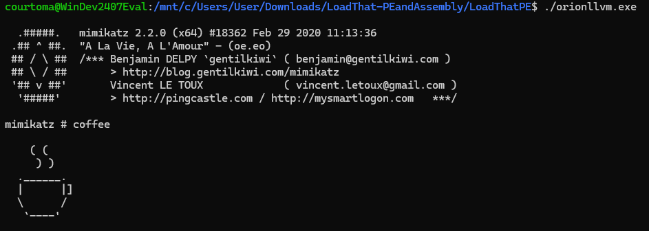
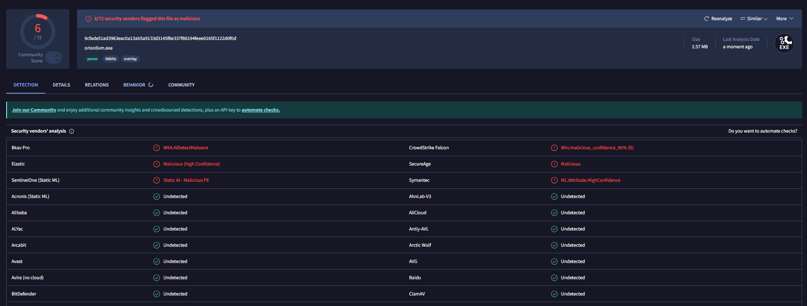

# Projet Orion : Rapport d'Activité — Équipe Bypass

> **Note de l'équipe** : Ce document retrace nos avancées sur les techniques d'évasion d'Antivirus et d'EDR.

## Objectifs

L'équipe **Bypass** est responsable de la neutralisation des mécanismes d'analyse statique et comportementale des systèmes d'exploitation. L'objectif final est de permettre l'exécution du malware développé par l'équipe *Ransomware* sans détection ni interruption par les solutions de sécurité (Antivirus/EDR).

Dans le cadre de ce Proof of Concept (PoC), nos efforts se sont concentrés sur le contournement de **Windows Defender** pour l'exécution de **Mimikatz** (extraction de *credentials* et manipulation de privilèges).

---

## Stratégie de Contournement

### Approches Passives (Considérées)
Plusieurs techniques de discrétion ont été étudiées :
* **Chiffrement des communications** : Sécurisation du flux entre le C2 et l'agent.
* **Fonctions Custom** : Implémentation d'une fonction `sleep` personnalisée pour contrer l'accélération de l'horloge (système de sandbox propre à un EDR).

### Approche Retenue : Packer/Loader & Obfuscation LLVM
Pour offrir une solution flexible et universelle, nous avons développé un **Loader de Native PE** couplé à des *LLVM passes* grâce à l'outil **OLLVM**. Cette méthode permet d'invisibiliser n'importe quel binaire via une simple ligne de commande.

---

## Introduction des Outils

**Windows Defender** est un outil d'analyse statique, conçu pour analyser les fichiers présents dans le disque dur et signaler leur éventuelle dangerosité au kernel de l'OS. Il est souvent couplé à un outil d'Endpoint Detection & Response (**EDR**), qui s'occupe de l'analyse comportementale d'un fichier (lors de son exécution).

Pour pouvoir exécuter le malware développé par l'équipe *DevRansomware* sur la machine compromise, il faut éviter sa détection statique par Windows Defender, et ainsi empêcher sa suppression du système de fichiers. L'utilisation d'un **loader** permet de contourner ce problème.

### Le Loader
L'intérêt du loader est de pouvoir charger un exécutable directement en RAM (**"exécution Fileless"**), sans aucune présence sur le disque dur, et ainsi éviter l'analyse statique de Windows Defender.

* **Le fonctionnement classique** : En principe, l'exécution d'un fichier repose sur le *Windows Loader*, un programme qui interagit directement avec le kernel : il charge le programme en mémoire et ordonne son exécution.
* **Notre solution** : Le custom loader que nous utilisons agit comme un substitut du *Windows Loader*. Il réalise son travail à sa place de façon à interagir le moins possible avec le kernel. On évite ainsi les *hooks* des outils de détection sur certaines fonctions Windows sensibles, et l'exécutable n'est pas présent en dur.

Ce loader est lui-même généré par un **packer**, un script Python qui s'occupe d'obfusquer le code source du loader. 

Pour rendre notre malware encore plus robuste, nous avons décidé d'inclure des **LLVM passes** lors de la compilation, c'est-à-dire des fonctions qui vont obfusquer le code LLVM IR lors de son optimisation.

> **En bref :** L'assemblage de ces éléments constitue notre bypass de Windows Defender pour l'exécution d'un malware.

---

## Plan

1. **Exécuter un programme** : avant de commencer à parler de loader, il faut comprendre les étapes lors de l'exécution d'un programme.
2. **Le custom loader**
3. **Le custom packer**
4. **L'obfuscation LLVM**

---

## 1. Exécuter un programme
*Résumé des étapes lorsqu’on ordonne l’exécution d’un programme.*

### Étape 1 : Création de l’environnement d’exécution
Le noyau crée un processus, lui alloue une mémoire virtuelle, et crée un thread initial.

La **mémoire virtuelle** allouée contient : 
* Les données du PE (`.text`, `.data`, `.rdata`, dont l’IAT, `.rsrc`, `.reloc`, etc.).
* Les bibliothèques partagées (DLL comme `ntdll.dll`, `kernel32.dll`, etc.).
* Une mémoire dynamique (*Heap*, si on alloue de la mémoire lors de l’exécution).
* Une pile d’exécution (*Stack*, avec @retour pour les instructions, etc.).
* La table des descripteurs (*handle table*, qui gère l’accès aux fichiers utilisés par le programme).
* Un token (définit les privilèges d’accès du processus lors de son interaction avec le noyau).
* Le PEB (une structure en mémoire accédée par le loader pendant l’exécution contenant des modules chargés, arguments, etc.).

Le **thread initial** est un fil d’exécution qui accompagne le processus. Il sert à enregistrer l’état de l’exécution pour que le processeur puisse prendre le relais. Il est composé :
* D’une pile d’exécution
* De registres
* D’un registre *RIP* qui pointe vers l’adresse de la prochaine instruction.

### Étape 2 : Activation du loader pour charger le PE en RAM
Lorsqu’on donne l’ordre d’exécution, le noyau configure le registre *RIP* du thread pour pointer vers l’instruction chargée d’initialiser le loader, située dans la bibliothèque `ntdll.dll`. 

Instructions exécutées (dans l’ordre) :
1. `LdrInitializeThunk` : configure la gestion des exceptions.
2. `LdrpInitialize` : configure les structures du PEB.
3. `LdrpInitializeProcess` : mappe les sections du binaire brut, résout les dépendances (charge les adresses des DLL dans l’IAT), et applique les permissions de sécurité.

Après cette étape, le thread appelle le point d’entrée de chaque DLL (le thread fait le `DLLMain`), puis récupère l’adresse du point d’entrée du programme. Le registre RIP est modifié pour y pointer.

> Le loader est donc une **séquence d’instructions de la ntdll.dll** (la bibliothèque bas niveau entre l'espace utilisateur et le noyau).

### Étape 3 : Exécuter les séquences d’instructions du PE (.text)
Le processeur récupère les données enregistrées par le thread et exécute les instructions binaires contenues dans `.text`. Ce dernier interagit avec les autres sections (IAT, Heap, Stack).

---

## 2. Le Custom Loader

Un custom loader doit faire exactement le même travail que le Windows Loader. Cependant, il **ne remplace pas** ce dernier. On exécute le custom loader dans lequel on a intégré notre PE (XORé et obfusqué).

**Les étapes sont les suivantes :**
1. On ordonne l’exécution du custom loader.
2. Le Windows loader fait son travail, et exécute le custom loader.
3. Le custom loader s’occupe de loader le vrai exécutable en RAM :
    * *Parsing* des en-têtes PE (découpage des chunks, tailles, placement mémoire).
    * Allocation mémoire (`VirtualAlloc`), copie des chunks (`memcpy`).
    * Relocalisation des sections du `.reloc` (application d'un delta d’adresses).
    * Résolution des importations (trouver les fonctions DLL et écrire dans l’IAT).
    * Appel du point d’entrée du `.text` (après les `DLLMain`).

**Contournement des EDR :**
Les EDR placent des *hooks* dans la `ntdll.dll` pour intercepter les syscalls suspects (`VirtualAlloc`, etc.). Pour contourner cela, le loader récupère sur le disque dur une version propre de la `ntdll.dll` (non hookée) et écrase celle située dans la mémoire virtuelle du processus. 
De plus, les chunks du PE sont obfusqués via XOR et renommage aléatoire pour échapper aux signatures statiques.

---

## 3. Le Custom Packer

Le **packer** est le script Python qui génère le code C++ du loader obfusqué à partir de la charge utile (`.exe`). 

**Ce que gère concrètement le packer :**
* Il divise l’exécutable initial en chunks et effectue 10 à 20 opérations XOR pour les chiffrer. Les clés sont dynamiques et changent à chaque compilation.
* Il randomise les noms des variables et des fonctions du loader.

> Grâce à ces opérations, les analyseurs statiques sont incapables de repérer le loader avant son exécution.

---

## 4. L'Obfuscation LLVM

**LLVM** est un environnement intermédiaire de compilation. Il crée un code intermédiaire (LLVM IR), l'optimise, puis génère le code binaire cible.

L’obfuscation LLVM (via l'outil **ollvm16**) détourne l’étape d’optimisation en y injectant des **« LLVM passes »** malveillantes :
* **Control Flow Flattening (FLA)** : "Aplatit" la logique en insérant tout dans un `switch` central contrôlé par une variable d'état.
* **Bogus Control Flow (BCF)** : Ajoute du *junk code* (code mort, équations complexes) pour noyer le code légitime.
* **Substitution d’instructions (SUB)** : Transforme des mathématiques simples en opérations logiques complexes (`XOR`, `AND`, `NOT`).

**Comment ça marche ?**
On ajoute des attributs dans le code `.cpp` (ex: `__attribute((annotate("fla")))`). Lors de la compilation, LLVM lit ces métadonnées et applique la passe correspondante à la fonction ciblée.

**Objectifs :**
* **Pénalité de performance** : Le code mort ralentit l'exécution, ce qui aide à fuir les *sandboxs* d'EDR (qui ont un temps limité).
* **Résistance au Reverse Engineering** : Le code décompilé devient illisible.
* **Destruction des signatures** : Chaque compilation génère une suite d'octets unique.

---

## En résumé : Que fait concrètement l'outil ?

1. **Première étape :** Génération du loader obfusqué via le script Python (packer).
2. **Deuxième étape :** Compilation du loader incluant la charge utile et les bibliothèques portables.
3. **Troisième étape :** Application des *LLVM passes* pour obfusquer le code IR, détruire les signatures et complexifier l'analyse.

---

## En résumé : Comment utiliser l'outil ? 

**1. Génération du code source obfusqué (Python) :**
```bash
python3 encrypt_pe.py <TARGET_MALWARE.exe> <LOADER_CODE.cpp>
# Exemple : python3 encrypt_pe.py mimikatz.exe encrypted_pe.cpp
```

**2. Compilation du loader avec flags d'obfuscation :**
```bash
# Commande simplifiée
clang++ <LOADER_SOURCE.cpp> -o <LOADER_MALWARE.exe> 

# Exemple complet 
/home/user/llvm-project/build/bin/clang++ \		
-target x86_64-pc-windows-gnu \
-I usr/lib/gcc/x86_64_w64-mingw32/14-posix/include/c++ \
-I usr/lib/gcc/x86_64_w64-mingw32/14-posix/include/c++/ x86_64_w64-mingw32 \
-L usr/lib/gcc/x86_64_w64-mingw32/14-posix \
-L usr/ x86_64_w64-mingw32/lib  \		
-static encrypted_pe.cpp -o orion.exe \
-Wl,--start-group -lstdc++ -lpthread -lmingw32 -lgcc -lgcc_eh -Wl,--end-group
```
**à noter :** les flags d'obfuscation sont intégrés directement dans le code source du packer
**à noter :** les options sont détaillées plus bas dans "Utilisation de MSYS et MinGW"

---

### Installations et configurations 
_(grâce au gestionnaire de paquets `winget`)_

**Git :** pour cloner les projets `llvm-project`, `ollvm16`, `mimikatz`.
**CMake :** pour générer les fichiers de configuration de compilation (`Makefile`).
**Python :** pour l'exécution de scripts Python (notre packer)
**Visual Studio Build Tools 2022 :** Outils C++ (compilateur, éditeur de liens, SDK Windows).
**MSYS2 :** Plateforme émulant un environnement Unix sous Windows.
**MinGW-w64 GCC :** Compilation GNU via MSYS2 pour fournir les bibliothèques standards à `clang`.

---


### Utilisation de MSYS2 et MinGW :

Outils qui permettent de porter des logiciels Unix sous Windows. L’utilisation de MinGW simule un environnement Unix lors de la compilation. Cela permet entre eux de résoudre les problématiques d’interopérabilité (un fichier compilé avec MinGW sera exécutable sur un environnement Windows ou Unix).

**Praticité :**
* Déploiement sans dépendance : MinGW intègre la bibliothèque msvcrt.dll dans le programme (native à toutes les versions de Windows, elle est nécessaire pour exécuter un programme sous Windows) 
* Cross-compilation : MinGW permet par ex de générer un fichier exe compatible Windows à partir d’une compilation sur Linux
* Le lien avec les autres outils : llvm et ollvm sont conçus pour le monde Unix

**Performances :**
* MinGW génère un binaire plus léger (donc rapide) que le compilateur Microsoft de base (MSVC)
* Meilleure gestion de l’option `--static` (qui permet de forcer l’intégration de tous les éléments nécessaires à l’exécution dans le fichier `.exe` final).


L’utilisation de MinGW se fait lors de la compilation, en intégrant des options à la ligne de commande. 

`-target x86_64-pc-windows-gnu` : ordonne au compilateur clang de générer un binaire déstiné à un processeur 64bits, tournant sur Windows, et respectant l’ABI de GNU (ie on bascule sur MinGW au lieu de MSVC)

`-I <chemin>` : _include directory :_ indique au compilateur les dossiers supplémentaires dans lesquels il doit chercher des fichiers d’en-tête (comme <stdio.h> par ex)

`-L <chemin>` : _library directory :_ indique à l’éditeur de liens où trouver les bibliothèques binaires précompilées (une fois le code compilé le linker lie le programme aux fonctions natives de l’OS, d’où le besoin de les inclure pour la portabilité)

`-Wl,--start-group -lstdc++ -lpthread -lmingw32 -lgcc -lgcc_eh -Wl,--end-group` : _spécifique pour le linker :_ on lui lie manuellement les bibliothèques dont il a besoin, et on le force à lire en boucle les bibliothèques jusqu’à ce que toutes les dépendances croisées (i.e dépendance circulaire : la bib A a besoin de la bib B, et la bib B a besoin de la bib A) soient résolues

--- 


## 🛠️ Phase de tests 

En téléversant notre loader sur un site internet et en récupérant celui-ci depuis un vm cible avec Windows Defender activé, on teste :



Le résultat nous donne une exécution de mimikatz (certes lente car mimikatz est énergivore en ressources) qui n’est pas détectée par le Windows Defender.

On vérifie aussi avec VirusTotal sa performance :


